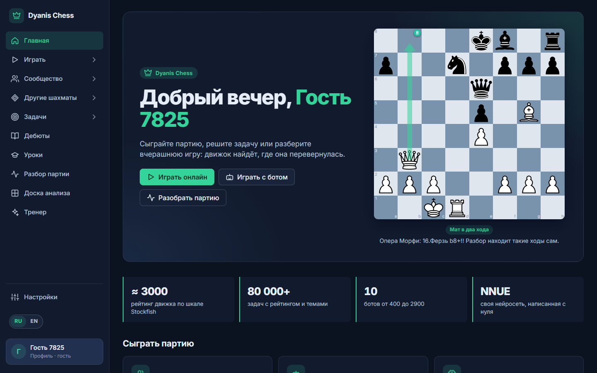
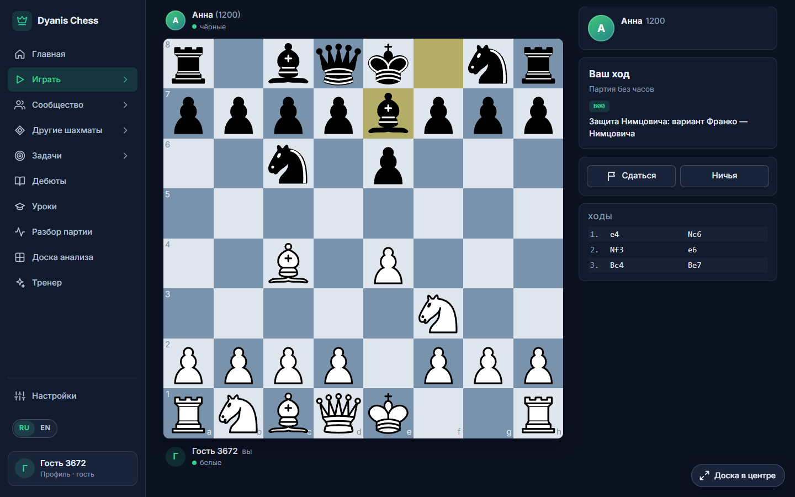
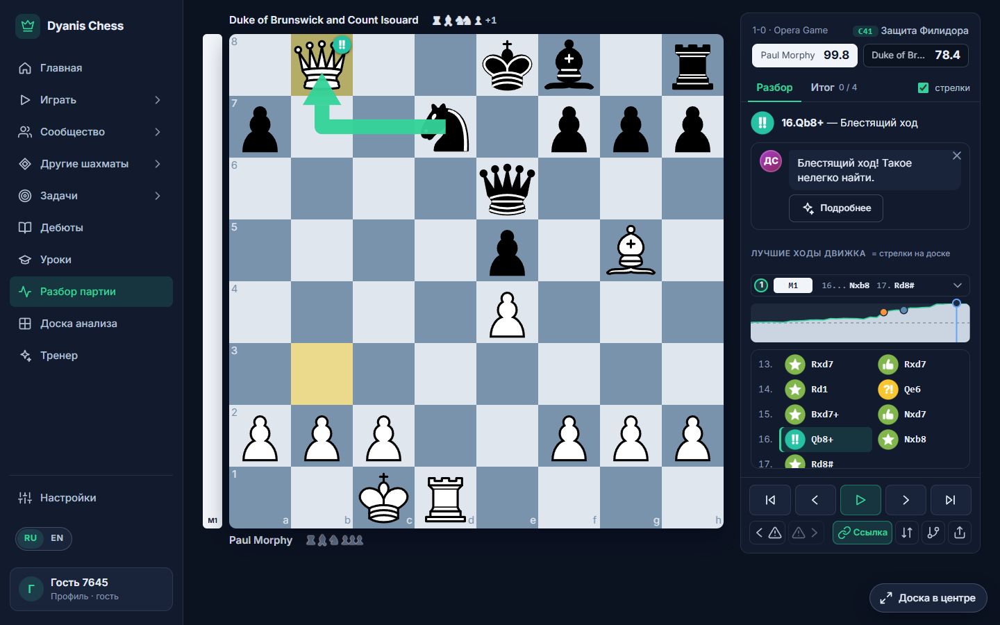
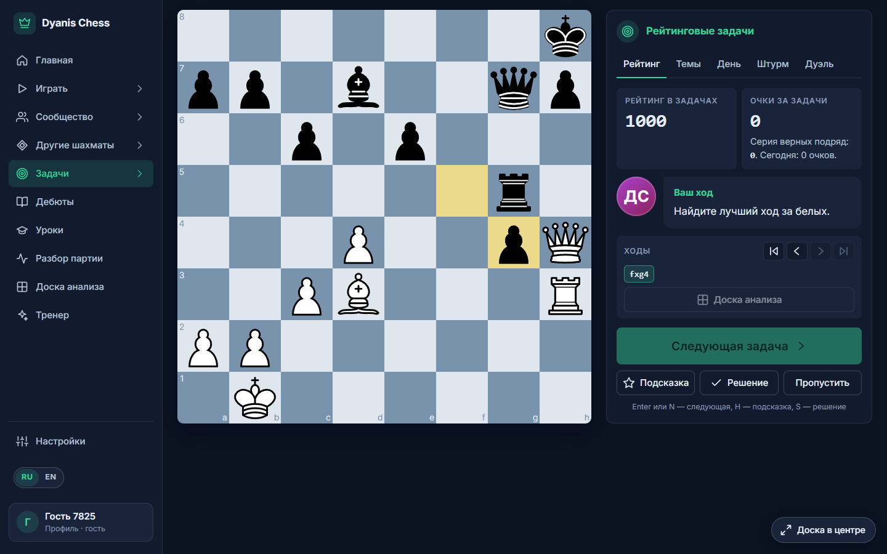
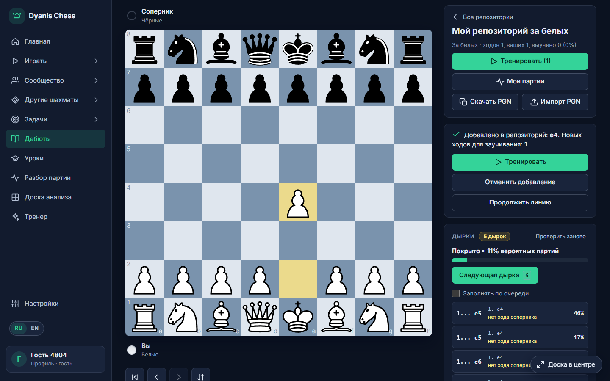

# Dyanis Chess

Шахматная платформа на **собственном шахматном движке с нейросетью**. Игра онлайн и с ботами, разбор партий со значками ходов, шахматные задачи, тренажёр дебютов, рейтинги. Движок, нейросеть и сайт написаны с нуля.

Движок играет примерно на **3000 по шкале `UCI_Elo` Stockfish 19** (измерено 3024 ± 35) (500 мс на ход, один поток).

## Как это выглядит

| | |
|---|---|
|  |  |
| Главная: «Опера Морфи» и разбор находит блестящий ход сам | Партия с ботом: название дебюта в реальном времени |
|  |  |
| Разбор: значки ходов, график, линии движка, подсказки Диониса | Рейтинговые задачи, подсказка, решение, отмотка ходов |
|  | |
| Репозиторий ходов: статистика Lichess, оценка ходов и «дырки» | |

## Что можно делать

**Играть**
- **Онлайн с живым соперником**: сайт подбирает игрока с близким рейтингом (рейтинговая или обычная партия, от пули до рапида) или создаёт партию для друга по ссылке. Часы ведёт сервер, есть чат, премувы (до 30 ходов подряд), подтверждение хода. Два аккаунта одного человека не могут играть друг с другом на рейтинг.
- **С ботами**: 10 персонажей с рейтингами от 400 до 2900, у каждого свой характер и реплики. За первую победу над ботом начисляются очки.
- **Против движка**: полная сила (нейросеть и книги дебютов, ≈ 3000), выбор цвета и часов. Есть и облегчённая версия прямо в браузере без сервера, она тоже играет с нейросетью.
- **Другие шахматы** (десять видов, с живым соперником, без рейтинга): Туман войны, Dice chess, Утиные, Слепые, Атомные, Crazyhouse, Шведские (на четверых), Царь горы, Орда и Chess960.

**Разбирать партии**
- Вставьте PGN или разберите только что сыгранную партию: оценка каждого хода, график, точность игроков, названия дебютов, лучшие продолжения.
- Ходы получают значки от «зевка» до «блестящего хода».
- Можно ходить на доске из любой позиции партии: движок сразу оценит вашу идею.
- Три лучшие линии движка для каждой позиции.
- **ИИ-тренер** объясняет ход словами и показывает на доске, что нужно было сыграть и как ошибка наказывается. Ходы считает движок, нейросеть через OpenRouter только пишет текст (нужен ключ, без него тренера нет).

**Решать задачи**
- Около 80 000 задач Lichess с рейтингом, подбор по уровню и теме, задача дня; по желанию режим очков вместо рейтинга.
- **Тактический штурм**: от лёгких задач к сложным до первой ошибки, на время.
- **Тактическая дуэль**: два игрока решают одни и те же задачи наперегонки.

**Учить дебюты**
- Свой репозиторий ходов: сайт предлагает продолжения (теория, статистика Lichess, ход движка) и оценивает каждое.
- Тренировка с интервальным повторением, разбор ваших партий (где вы вышли из репозитория), импорт и экспорт PGN.
- Репозиторий понимает **транспозиции** (одна позиция, достигнутая разным порядком ходов, считается один раз) и показывает «дырки»: популярные ответы соперника, на которые у вас нет хода.

**Рейтинги**: система Glicko-2 (как на chess.com и Lichess) отдельно для пули, блица, рапида и дуэлей; таблица лидеров, публичные профили игроков, статистика и серия дней в профиле.

**Русский и английский** интерфейс. Профиль со страной и аватаром, достижения, светлая тема.

**Сообщество**: друзья, личные сообщения, вызовы на партию (друга можно отключить, если вызовы надоели), заочные партии с днями на ход и режимом отпуска, форум и таблица лидеров с фильтром по странам; блокировка игроков и жалобы модераторам.

**Уроки**: 35 коротких уроков с упражнениями на доске, от ходов фигур до матовых комбинаций и эндшпиля.

**Тренер**: личный план на день и советы по вашим партиям и задачам (вкладка «Тренер»), без нейросети.

Тёмный интерфейс, режим «Доска в центре», темы досок, фигур и звуков, настройки игрового процесса.

## Движок

- Написан на Go **без сторонних библиотек**: битборды, поиск (альфа-бета, Lazy SMP), таблица транспозиций, ручная оценка с весами, подобранными Texel-тюнингом.
- **Собственная нейросеть NNUE** (768 входов с корзинами по положению короля, 256 нейронов, SCReLU), обучена в PyTorch на партиях, которые сыграл сам движок. Вывод на Go, с SIMD быстрее.
- Работает как **UCI-движок** в Arena, CuteChess и других программах, собирается в **WebAssembly** (бот в браузере).
- Сила измеряется матчами, не числом узлов; есть инструменты матчей со статистикой (SPRT), SPSA-подбор параметров и генерация данных.

Против Stockfish 19 (500 мс на ход, один поток, по 200 партий на уровень):

| `UCI_Elo` Stockfish | Результат нашего движка | Оценка |
|---|---|---|
| 3000 | +64 =86 −50 | ≈ 3024 |

Шкала `UCI_Elo` откалибрована на длинном контроле времени и не равна рейтингу FIDE. Подробности в [`engine/plan.md`](./engine/plan.md).

## Технологии

| Часть | Что использовано |
|---|---|
| Движок | Go, NNUE, SIMD (AVX2), WebAssembly, UCI |
| Обучение сети | Python, PyTorch |
| Сервер | Go (стандартная библиотека, WebSocket), MySQL 8 |
| Сайт | React, Vite, react-chessboard |
| Запуск | Docker Compose, nginx |
| Вход | гость в один клик или Google OAuth |

## Запуск

Нужен Docker.

```bash
cp .env.example .env          # впишите свои пароли (буквы и цифры)
docker compose up --build     # сайт: http://localhost:8080
```

Схема базы создаётся сама. Вход через Google и статистика Lichess необязательны (см. `.env.example`). Базу задач нужно загрузить один раз, как это сделать, описано в [`DEVELOPERS.md`](./DEVELOPERS.md).

Играть против движка в терминале (нужен Go):

```bash
cd engine
go run ./cmd/cli -play -movetime 1000 -evalfile net-kingf-m4.bin
```

## Устройство

```
engine/    движок, нейросеть, обучение и инструменты матчей
backend/   сервер: разбор партий, онлайн-игры, подбор, рейтинги, задачи, дебюты, API
web/       интерфейс на React
deploy/    Dockerfile'ы и конфигурация nginx
```

Сервер видит движок только через небольшой интерфейс [`engine/engine.go`](./engine/engine.go), поэтому движок можно заменить, не трогая остальной код. Тесты движка, сервера и интерфейса запускаются командами `go test ./...` и `npm test` (в `web/`).

## Документация

- [`DEVELOPERS.md`](./DEVELOPERS.md): подробное описание сайта и движка, команды, настройка, структура.
- [`WEB-PLAN.md`](./WEB-PLAN.md): план, решения и журнал работ.
- [`engine/TECHNICAL.md`](./engine/TECHNICAL.md), [`engine/NNUE.md`](./engine/NNUE.md), [`engine/plan.md`](./engine/plan.md): устройство движка, нейросеть, эксперименты и измерения.

## Состояние

Проект функционально завершён. Готово: игра, разбор с ИИ-тренером, задачи, дебюты, рейтинги, подбор, дуэли, уроки, тренер, десять видов шахмат, сообщество (друзья, сообщения, вызовы, заочные партии, форум), достижения, русский и английский язык. Публичный сервер пока не запущен: сайт работает локально в Docker. Подробнее в [`WEB-PLAN.md`](./WEB-PLAN.md).
